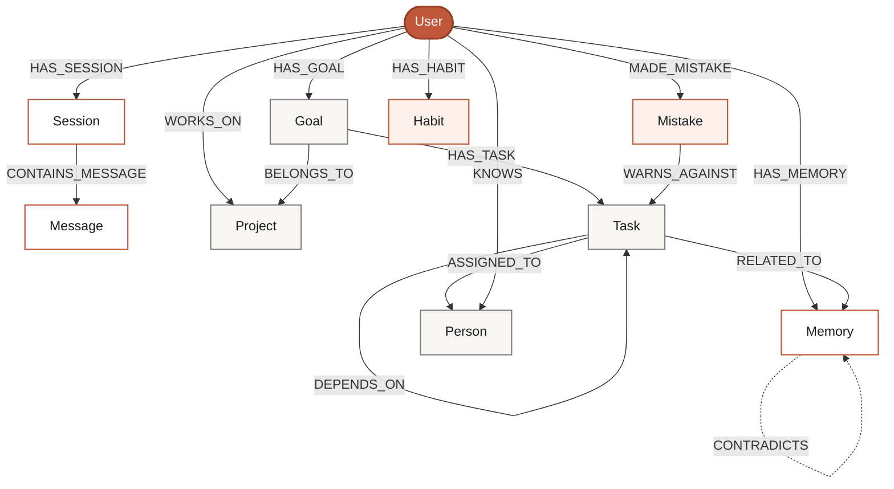

# GraphMind OS

GraphMind is a small, working multi-agent memory MVP. FastAPI stores messages, memories, goals, tasks, and agent events as connected FalkorDB nodes. The Planner reads the active goal and its connected task statuses from FalkorDB to recommend the next open task. The chat UI displays the retrieved records and graph paths that informed each answer.

## Run locally

1. Install Docker Desktop and start it.
2. Copy `.env.example` to `.env`. The defaults use FalkorDB on the Compose network and deterministic local answers, so no paid API key is needed.
3. Run `docker compose up --build`.
4. Open the UI at [http://localhost:3001](http://localhost:3001), API docs at [http://localhost:8000/docs](http://localhost:8000/docs), and FalkorDB Browser at [http://localhost:3000](http://localhost:3000).

FalkorDB persists data in the `falkordb_data` Docker volume. Check connectivity at `GET /api/health`. Set `LLM_PROVIDER=groq` with `GROQ_API_KEY` (and optionally `GROQ_CHAT_MODEL`) or `LLM_PROVIDER=openai` with `OPENAI_API_KEY` and optionally `CHAT_MODEL` to enable AI chat completions. The legacy `LLM_API_KEY` and `LLM_MODEL` settings remain deprecated aliases for OpenAI. The deterministic mode still writes and reads actual FalkorDB records; it is not a memory mock. `X-User-ID` selects a workspace (the UI currently uses `demo-user`).

## Demo scenario

In Chat, send:

> I'm building GraphMind OS for a hackathon. My goal is to finish the MVP by Sunday. I have completed the chat interface, but the graph retrieval is still pending.

The Memory Agent stores a user message, an active Sunday goal, one completed task, one pending task, and linked memory records. Start a new conversation (or refresh the page) and ask “What should I work on next for my hackathon project?” The Planner queries the graph-connected active goal and task nodes, recommends graph retrieval, and returns evidence with the `User → Goal → Task → RELATED_TO → Memory` path. Mark a task complete in Goals & Tasks, then ask again to see the shared state change the recommendation. Agent Activity includes an explicit Reflection run that reports possible conflicts without deleting history.

## Architecture and graph schema

* `frontend/` — Next.js, React, TypeScript, and Tailwind CSS. The relationship map is rendered with SVG from live API graph results; no sample graph is hardcoded.
* `backend/app/main.py` — validated FastAPI API, deterministic extraction, orchestration, and optional provider adapter.
* `backend/app/graph.py` — FalkorDB connection and all application-controlled, parameterized Cypher.
* `docker-compose.yml` — FalkorDB with persistent storage, API, and UI.

Node labels: `User`, `Session`, `Message`, `Memory`, `Goal`, `Task`, `Agent`, `Project`, `Person`, `Mistake`, `Habit`. Memory IDs and entity IDs use deterministic sha256 hashes or UUIDs. Properties include user ID, timestamps, source, confidence, task status/priority, and content. The graph schema supports:
- **Core Organization**: `HAS_SESSION`, `CONTAINS_MESSAGE`, `HAS_MEMORY`, `RELATED_TO`, `HAS_GOAL`, `HAS_TASK`
- **Execution & Dependencies**: `DEPENDS_ON` (Task → Task), `ASSIGNED_TO` (Task → Person), `WORKS_ON` (User → Project), `BELONGS_TO` (Goal → Project)
- **Cognitive & Experience**: `MADE_MISTAKE` (User → Mistake), `WARNS_AGAINST` (Mistake → Task), `HAS_HABIT` (User → Habit)
- **Truth Evolution & Conflict**: `SUPERSEDES` (New → Old Memory), `CONTRADICTS` (Disputed Memory Pairs)



Indexes are maintained for `(User.id)`, `(Memory.user_id)`, `(Task.user_id)`, `(Goal.user_id)`, `(Project.user_id)`, `(Person.user_id)`, `(Mistake.user_id)`, and `(Habit.user_id)` at startup.

### How the Agents Query the Graph

The multi-agent system uses deterministic, parameterized Cypher queries scoped strictly by `user_id`:

1. **Memory Ingestion & Reinforcement (`Memory Agent`)**
   - User messages are parsed into extracted entities (goals, tasks, facts).
   - Memories are upserted with `MERGE`. Re-observed memories increment `reinforcement_count` and boost confidence.

2. **Goal-First Context Retrieval (`Planner Agent`)**
   - When a user asks planning questions (*"What should I work on next?"*), the Planner traverses from the user's active goal to connected tasks, dependency chains, and grounding memory facts:
   ```cypher
   MATCH (u:User {id:$uid})-[:HAS_GOAL]->(g:Goal)-[:HAS_TASK]->(t:Task)
   OPTIONAL MATCH (t)-[:RELATED_TO|DEPENDS_ON*0..2]-(connected) WHERE connected.user_id=$uid
   WITH u, g, t, collect(DISTINCT connected) AS linked
   RETURN u, g, t, linked LIMIT $lim
   ```

3. **Cognitive Guardrails & Mistake Prevention**
   - Before recommending an open task, the agent checks if any known failure mode points to it:
   ```cypher
   MATCH (m:Mistake {user_id:$uid})-[:WARNS_AGAINST]->(t:Task {id:$task_id})
   RETURN m.description, m.prevention_rule
   ```

4. **Conflict Resolution & Auditing (`Reflection Agent`)**
   - When conflicting facts are identified, the agent links them with bidirectional `[:CONTRADICTS]` edges and marks their status as `disputed`. Audit history is preserved without destructive deletions.


Create/merge user-scoped memories with reinforcement:

```cypher
MERGE (u:User {id:$uid})
MERGE (m:Memory {id:$mid, user_id:$uid})
ON CREATE SET m.content=$content, m.kind=$kind, m.source=$source,
  m.confidence=$confidence, m.created_at=$now, m.status='active', m.reinforcement_count=1
ON MATCH SET m.updated_at=$now,
  m.confidence=CASE WHEN m.confidence < $confidence THEN $confidence ELSE m.confidence END,
  m.reinforcement_count=coalesce(m.reinforcement_count, 1) + 1
MERGE (u)-[:HAS_MEMORY]->(m)
```

Graph-native conflict resolution:

```cypher
MATCH (ma:Memory {id:$ida, user_id:$uid}), (mb:Memory {id:$idb, user_id:$uid})
SET ma.status='disputed', mb.status='disputed'
MERGE (ma)-[r1:CONTRADICTS]->(mb) SET r1.reason=$reason, r1.created_at=$now
MERGE (mb)-[r2:CONTRADICTS]->(ma) SET r2.reason=$reason, r2.created_at=$now
```

Planner context starts with the current user and traverses their active goal to connected tasks, evaluates task dependency chains (`DEPENDS_ON`), and traverses connected `Mistake` nodes (`WARNS_AGAINST`) to caution against recurring failure modes. All traversals strictly constrain every visited node to the querying user ID.

## API

All endpoints use the optional `X-User-ID` header (`demo-user` by default). API explorer: `/docs`.

* `POST /api/chat` — save message, extract structured memory (goals, tasks, mistakes, habits, projects), traverse graph, and answer.
* `GET /api/sessions` and `GET /api/sessions/{session_id}/messages` — scoped conversation history.
* `GET /api/memories`, `GET /api/graph`, `GET /api/goals` — scoped graph views and live relationship topology.
* `POST /api/tasks`, `PATCH /api/tasks/{task_id}`, `POST /api/tasks/{task_id}/dependency` — create/update task state and dependency edges.
* `GET /api/projects`, `POST /api/projects` — project management and goal association.
* `GET /api/people`, `POST /api/people` — collaborator and stakeholder entity tracking.
* `GET /api/mistakes`, `POST /api/mistakes` — lessons learned and mistake avoidance rules.
* `GET /api/habits`, `POST /api/habits` — recurring patterns and behavioral preferences.
* `POST /api/agents/reflect`, `GET /api/agents/activity` — reflection with graph-native `[:CONTRADICTS]` edge creation and agent event log.
* `GET /api/health` — FalkorDB connectivity check.

## Security and limitations

No credentials are committed; `.env.example` contains placeholders. LLMs do not execute arbitrary Cypher. User IDs are validated and every API graph query is scoped by user ID. Reflection reports candidate conflicts, marks them in the graph with `[:CONTRADICTS]`, and preserves audit history without silent deletion. The deterministic extractor handles common phrases for goals, task statuses, mistakes, and habits. The UI currently selects the `demo-user` workspace; production deployments should add authentication and derive the user ID from verified identity rather than trusting a request header. LLM integration currently supports deterministic mode and OpenAI chat completions.

## Verification and demo recording

Run the checks from a clean checkout. Install the locked backend development environment with [uv](https://docs.astral.sh/uv/):

```sh
cd backend
uv sync --locked --group dev
uv run ruff check app tests
uv run mypy app
```

Run the database-backed backend tests with Docker and the isolated test graph:

```sh
cd ..
docker compose -f docker-compose.yml -f docker-compose.test.yml run --build --rm backend-tests
```

For the frontend checks, run `npm ci`, `npm run lint`, `npx tsc --noEmit`, and `npm run build` from `frontend/`. Provide `NEXT_PUBLIC_API_URL` and `NEXT_PUBLIC_WS_URL` when building the Docker image; the Compose defaults target the local API.

Then follow the demo scenario and confirm node/edge changes in the FalkorDB Browser.

For a short demo video, record the first prompt, the answer’s “Why this answer?” evidence, a refresh/new conversation, the Planner recommendation, a task status update, and the changed recommendation. The project was created with AI coding assistance; the human team should review and understand the code and technical decisions before submission.
